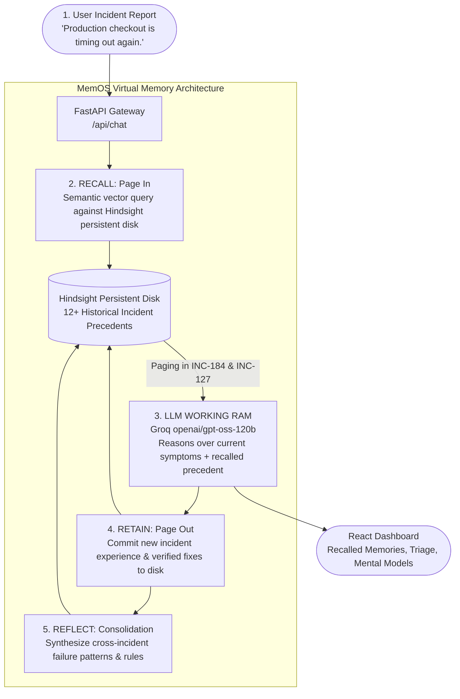

# MemOS Agent
## Virtual Memory Architecture for Autonomous AI Agents

> **Site Reliability Engineering (SRE) DevOps Incident Response Agent powered by Groq and Hindsight Persistent Memory.**

[](file:///tests/)
[](file:///frontend/src/App.test.js)
[-orange)](https://groq.com)
[](https://vectorize.io)

---

## 1. The Problem: Stateless AI Agents
Current AI agents operate as **stateless compute**. In traditional architectures, an LLM context window is initialized with a generic prompt, processes user input, and terminates. 

When a production outage concludes:
- All diagnostic discoveries, root cause analyses, and verified remediations evaporate with the context window.
- The next time a similar incident occurs—whether days, weeks, or months later—the agent starts from **zero operational context**.
- Engineering organizations suffer from repeated "rediscovery cycles," where previously diagnosed failure patterns (e.g., Redis pool exhaustion, unindexed database locks, CPU throttling) must be investigated from scratch.

---

## 2. The Solution: Hindsight Persistent Memory
**MemOS** wraps an LLM working context in an operating-system-inspired **Virtual Memory Architecture** powered by **Hindsight Cloud**. 

Instead of treating memory as a simple flat chat log, MemOS structures operational experience into episodic incident records. The agent:
1. **Pages in** matching historical incidents right when incident symptoms correlate (**Recall**).
2. **Executes** high-velocity SRE diagnosis in working RAM (**Groq LLM**).
3. **Pages out** newly diagnosed incidents and verified remediations into durable secondary storage (**Retain**).
4. **Consolidates** multiple experiences into reusable operational mental models (**Reflect**).

---

## 3. The Virtual Memory Analogy

MemOS maps the classical components of computer operating systems directly to autonomous AI agent memory:

| Operating System Concept | MemOS Agent Component | Role & Function |
|---|---|---|
| **RAM / Working Memory** | **LLM Context Window (Groq 120b)** | Fast, volatile working context where active SRE reasoning occurs. Disappears when the process/session finishes. |
| **Persistent Disk / Secondary Storage** | **Hindsight Memory Bank** | Durable external memory bank holding historical postmortems, runbooks, and failure signatures across all sessions. |
| **Page In** | **Recall** | Semantic retrieval of relevant historical incident precedents from Hindsight into the prompt context right when needed. |
| **Page Out** | **Retain** | Committing the newly diagnosed incident experience, root cause, and verified remediation out to Hindsight persistent disk. |
| **Memory Consolidation / Defrag** | **Reflect** | Cross-incident synthesis that aggregates individual incident records into high-level mental models and prescriptive operational rules. |

---

## 4. Virtual Memory Lifecycle Architecture



### Text Flow Representation:
```
User Incident Report
        ↓
FastAPI Orchestrator
        ↓
[PAGE IN]  Hindsight RECALL ──> Retrieves INC-184 (Redis connection pool exhaustion)
        ↓
[RAM]      Groq LLM ──────────> Cross-references precedent with active symptoms
        ↓
[PAGE OUT] Hindsight RETAIN ──> Commits new incident triage to persistent disk
        ↓
[CONSOLIDATE] Hindsight REFLECT ─> Synthesizes operational mental models & rules
        ↓
React SRE Dashboard
```

---

## 5. Why DevOps Incident Response?

DevOps and Site Reliability Engineering (SRE) represent the most natural, high-value domain for persistent agent memory:

1. **Repeated Failure Signatures:** Industry research shows that over 75% of production incidents share structural similarities with past outages (e.g., connection starvation during marketing spikes, cascading timeouts without circuit breakers, memory leaks under concurrency).
2. **Verified Remediations Save Critical Minutes:** A generic stateless LLM can only suggest textbook troubleshooting steps. A memory-augmented agent immediately references institutional postmortems: *"Incident #184 resolved this exact symptom on Checkout API by increasing Jedis `max-active` from 50 to 200 and setting wait timeout to 1500ms."*
3. **Verification Before Assumption:** Persistent memory does not mean blind guessing. MemOS explicitly compares historical evidence against current symptoms to formulate targeted hypotheses while mandating metric verification before configuration changes.

---

## 6. End-to-End Walkthrough Example

### User Query:
> *"Production checkout is timing out again."*

### Step-by-Step Agent Execution:

1. **Stage 1 — RECALL (Page In):**
   - Hindsight scans the persistent memory bank and retrieves `INC-184` (*Checkout API 504 Timeouts during flash sale traffic surge — Redis connection pool exhaustion*) and `INC-127` (*Payment Service timeouts during lock acquisition*).
2. **Stage 2 — REASON (LLM Working RAM):**
   - Groq (`openai/gpt-oss-120b`) receives the current incident prompt alongside the formatted historical precedent records.
   - It identifies that checkout timeouts frequently correlate with Redis connection exhaustion, while acknowledging alternative hypotheses (upstream gateway timeout, database locks).
3. **Stage 3 — RECOMMEND (Structured SRE Output):**
   - **Root Cause Hypotheses:** Primary hypothesis: Redis connection pool exhaustion on application nodes causing thread starvation (referencing `INC-184`).
   - **Investigation Steps:** Inspect Redis connection pool saturation (`redis-cli info clients`), collect checkout worker thread dumps, verify upstream gateway error rates.
   - **Remediation Actions:** Hot-reconfigure connection pool max-active limits, set fail-fast acquisition timeouts, rolling-restart checkout pods.
   - **Verification Steps:** Monitor Checkout API p99 latency (< 200ms) and verify Prometheus `redis_connected_clients` < 75%.
4. **Stage 4 — RETAIN (Page Out):**
   - The newly diagnosed incident experience is committed into Hindsight persistent storage for future recall.
5. **Stage 5 — REFLECT (Memory Consolidation):**
   - The Reflect engine updates cross-incident mental models:
     > *"Checkout timeouts frequently correlate with Redis connection saturation during traffic spikes. Previous incidents (INC-184, INC-127, INC-101) were resolved by increasing the connection pool, isolating lock managers, and validating Redis saturation before modifying application code."*

---

## 7. Deep Dive: Recall vs. Retain vs. Reflect

Understanding the distinct responsibilities of each memory primitive:

| Primitive | Virtual Memory Equivalent | Input | Output | Purpose |
|---|---|---|---|---|
| **RECALL** | **Page In** | Incident symptom query + Bank ID | Ranked list of structured historical incident records (`IncidentRecord`) | Dynamically primes the LLM working context with proven institutional precedents right when symptoms match. |
| **RETAIN** | **Page Out** | Completed incident triage, root causes, remediations, and verification | Durable record stored in Hindsight memory bank | Preserves operational experiences so future triage sessions can benefit from newly learned remediations. |
| **REFLECT** | **Memory Consolidation** | Stored history across all incidents in the memory bank | Consolidated mental models, recurring patterns, and prescriptive rules | Periodic or on-demand synthesis that extracts overarching operational principles across disparate incidents. |

---

## 8. ⚖️ Controlled Memory Impact Demonstration (Phase 7)

MemOS features a built-in **Memory Impact Evaluation Mode** accessible directly from the UI header:

```
[⚖️ Memory Impact (Cold vs Memory)]
```

### The Controlled Experiment:
The exact same incident query (e.g. *"Production checkout is timing out again."*) is submitted through two controlled evaluation paths:

- **Mode A: Cold Agent (Stateless / RAM Only):**
  - Evaluated with memory sync disabled (`use_memory=False`).
  - LLM receives only the immediate symptom with zero recalled precedents.
  - Produces generic, textbook troubleshooting steps.
- **Mode B: Memory-Enabled Agent (MemOS Persistent Recall):**
  - Evaluated with Hindsight persistent memory recall (`use_memory=True`).
  - LLM receives the immediate symptom + matching historical records (`INC-184`, `INC-127`).
  - Prioritizes targeted diagnostic checks and verified remediation playbooks.

### Key Principle:
The purpose is **not** to claim memory is always infallible, but to demonstrate that **persistent operational experience provides critical context, organizational depth, and triage velocity that a stateless agent cannot possess.**

Both modes use **100% genuine live LLM API responses** (no fabricated outputs).

---

## 9. 🛠️ Technology Stack & Architecture

- **Backend Framework:** [FastAPI](https://fastapi.tiangolo.com/) (Python 3.10+) with modern asynchronous lifespan handlers and CORS support.
- **LLM Working Memory:** [Groq](https://groq.com) SDK running `openai/gpt-oss-120b` with 25s timeout handling and resilient JSON extraction (with autonomous fallback engine).
- **Persistent Memory:** [Hindsight](https://vectorize.io) Cloud SDK (`hindsight-client`, `hindsight-client-api`) featuring semantic Recall, episodic Retain, and cross-incident Reflect consolidation.
- **Multi-Tenant Memory Bank:** Bank-level partitioned memory bank (`SimulatedMemoryBank`) supporting workspace/team isolation (`bank_id`) and preventing cross-user memory leakage.
- **Frontend Application:** React 19, Axios, Tailwind CSS, Lucide icons, responsive layout, animated lifecycle state tracker, and dark-mode styling.
- **Verification Suites:** Pytest (12 automated tests), React Testing Library (4 unit tests), and end-to-end Python demo verification (`scripts/verify_demo_flow.py`).

---

## 10. 🔌 API Endpoints Reference

| Method | Endpoint | Description | Sample Request / Parameters |
|---|---|---|---|
| `POST` | `/api/chat` | Main SRE incident triage executing the 4-stage Virtual Memory pipeline (Recall → LLM → Retain → Reflect). | `{"messages": [{"role": "user", "content": "..."}], "use_memory": true, "bank_id": "devops-demo-team"}` |
| `POST` | `/api/demo/compare-memory` | Phase 7 Memory Impact demo comparing Cold Agent vs. Memory-Enabled Agent for the same incident query. | `{"query": "Production checkout is timing out again.", "bank_id": "devops-demo-team"}` |
| `POST` | `/api/seed-incidents` | Deterministically seeds 12 realistic historical incidents into persistent memory and runs recall benchmarks. | `POST /api/seed-incidents?bank_id=devops-demo-team` |
| `GET` | `/api/incidents` | Returns the complete catalog of all 12 historical incident precedents stored in persistent memory. | `GET /api/incidents?bank_id=devops-demo-team` |
| `POST` | `/api/reflect` | Generates or fetches consolidated operational mental models, failure patterns, and prescriptive rules. | `{"bank_id": "devops-demo-team"}` |
| `GET` | `/api/reflect` | Backward-compatible GET endpoint for retrieving operational mental models. | `GET /api/reflect?bank_id=devops-demo-team` |
| `GET` | `/api/health` | Returns backend online status, active engine mode, bank ID, and seeded incident count. | `GET /api/health` |
| `POST` | `/api/config` | Dynamically updates runtime API keys (`groq_api_key`, `hindsight_api_key`, `bank_id`) and persists to `.env`. | `{"groq_api_key": "...", "hindsight_api_key": "...", "bank_id": "..."}` |
| `GET` | `/{full_path:path}` | Serves compiled React frontend production assets and SPA client routing. | `GET /` |

---

## 11. 🚀 Setup & Installation Instructions

### 1. Prerequisites
- Python 3.10+
- Node.js 18+ and npm
- (Optional) Groq API key (get one free at [console.groq.com](https://console.groq.com))
- (Optional) Hindsight Cloud API key

### 2. Environment Configuration
Create or inspect `.env` in the project root:
```bash
cp .env.example .env
```
Populate `.env` with your API keys:
```env
# Groq API Key for LLM Working Context (openai/gpt-oss-120b)
GROQ_API_KEY=gsk_your_groq_key_here

# Hindsight Cloud Key (Optional: local persistent fallback bank is used if unconfigured)
HINDSIGHT_API_KEY=your_hindsight_api_key_here

# Workspace / Team Bank ID
HINDSIGHT_BANK_ID=devops-demo-team

# Server Port
PORT=8000
```

### 3. Backend Startup
```bash
# Install Python dependencies
pip install -r requirements.txt

# Run the backend server
python -m uvicorn backend.main:app --host 127.0.0.1 --port 8000
```
Backend runs at `http://localhost:8000`. Baseline historical incidents are automatically verified and seeded on startup.

### 4. Frontend Startup
```bash
cd frontend
npm install
npm start
```
Frontend development server runs at `http://localhost:3000` (proxied to port 8000). Alternatively, access the compiled production build directly at `http://localhost:8000`.

### 5. Seeding Historical Incidents
- **From UI:** Click **"⚡ Seed 12 Incidents"** in the top navigation bar.
- **From CLI:**
  ```bash
  python backend/seed.py
  ```

---

## 12. 🧪 Automated Testing

### Run Backend Pytest Suite (12 Tests):
```bash
pytest tests/ -v
```
Verifies:
- `test_demo_flow.py`: Deterministic 8-step demo execution.
- `test_memory_impact.py`: Phase 7 Cold vs. Memory comparison scenarios.
- `test_memory_pipeline.py`: Recall parsing, Retain models, Reflect models, DevOps schema contracts, and incident seeding.

### Run Frontend React Unit Tests (4 Tests):
```bash
cd frontend
npm test -- --watchAll=false
```

### Run End-to-End Live Verification Script:
```bash
python scripts/verify_demo_flow.py
```

---

## 13. ⏱️ 60–90 Second Hackathon Demo Flow

Follow this exact script for a judge presentation:

| Time | Stage | Action & What to Show |
|---|---|---|
| **00:00–00:15** | **The Pitch** | *"AI agents are stateless compute. When an outage ends, their operational knowledge disappears. MemOS introduces a Virtual Memory Architecture where LLM context is RAM and Hindsight is persistent disk."* |
| **00:15–00:30** | **Persistent Storage** | Point to the **Persistent Incident Catalog** tab showing 12 seeded incidents across Redis, PostgreSQL, Kubernetes, Kafka, and API Gateway. Click **"⚡ Seed 12 Incidents"** to demonstrate instant persistence. |
| **00:30–00:55** | **The Incident** | Click the quick prompt: *"Production checkout is timing out again."*<br>Show the animated **Virtual Memory Lifecycle Bar** transition through: `User Incident → Recall (Page In) → Working RAM → Retain (Page Out) → Reflect`. |
| **00:55–01:15** | **Recalled Memory** | Open the **Recalled Memories (Page In)** panel. Highlight that Hindsight paged in `INC-184` (*Redis connection pool exhaustion*). Note that the LLM used this historical precedent to target Redis pool sizing rather than generic application code changes. |
| **01:15–01:30** | **Memory Impact** | Click **"⚖️ Memory Impact (Cold vs Memory)"**.<br>Show the side-by-side comparison: **Cold Agent** suggests generic triage; **Memory-Enabled Agent** prioritizes verified configuration fixes and references the **Reflect Operational Mental Model**. |

---

## 📄 License
MIT License. Built for the Hackathon demonstrating autonomous AI systems powered by Groq and Hindsight Cloud.
